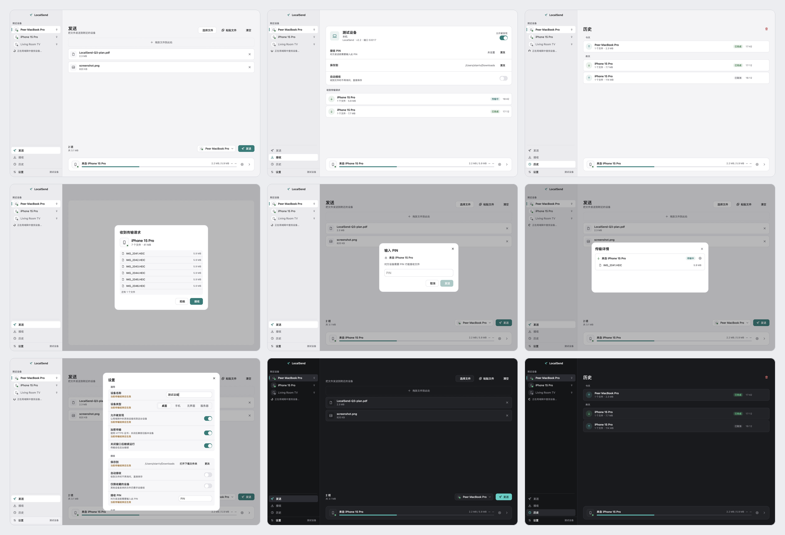

# LocalSend Desktop

LocalSend Desktop 是一款原生 [LocalSend](https://localsend.org) 桌面版，和官方 LocalSend 使用同一套传输协议，可以与手机、平板和其他电脑上的 LocalSend 互相收发文件；设备只要连在同一个 Wi-Fi 或局域网里，打开应用就能看到彼此。传输不经过云端，不需要账号，也不需要连接互联网。

**适合这些场景：**

- 把手机里刚拍的照片传到 Mac，不想经过微信、网盘或数据线
- 在两台电脑之间传一个大文件或整个文件夹
- 把一段文字、一个链接直接发到另一台设备上



**目录：** [主要功能](#主要功能) · [实现原理](#实现原理) · [安装指南](#安装指南) · [使用方法](#使用方法) · [常见问题](#常见问题) · [参与贡献](#参与贡献) · [上游项目与致谢](#上游项目与致谢) · [许可](#许可)

## 主要功能

| 功能             | 说明                                                                                                                       |
| ---------------- | -------------------------------------------------------------------------------------------------------------------------- |
| 自动发现设备     | 同一网络里的设备会自动出现在侧边栏，常用设备可以收藏置顶                                                                   |
| 发送文件和文件夹 | 拖进窗口、从访达选择，或直接粘贴；文件夹会保留原有的目录结构                                                               |
| 发送文字         | 一段文字或链接，对方收到后可以直接复制                                                                                     |
| 接收确认         | 有人发来文件时，先显示发送方、文件数量和大小，由你决定接收还是拒绝                                                         |
| 自动接收         | 可以开启自动保存，也可以限定只自动接收收藏设备发来的文件                                                                   |
| PIN 保护         | 设置 PIN 后，对方必须输入正确的 PIN 才能向你发送                                                                           |
| 传输历史         | 按日期记录每次收发，可以重新打开文件或在访达中显示                                                                         |
| 菜单栏常驻       | 关闭窗口后应用默认留在菜单栏继续运行，传输不会中断；点开菜单栏图标可以查看附近设备数量、传输进度和最近记录，随时回到主窗口 |
| 外观和语言       | 浅色、深色或跟随系统，支持简体中文和英文                                                                                   |

## 实现原理

**设备之间直连，数据不出局域网。** 应用启动后会在本地网络里广播自己，同时发现其他正在运行 LocalSend 的设备。传输时，文件从一台设备直接发往另一台，不会上传到任何服务器，所以不受网盘那样的容量限制，速度只取决于你的局域网。

**默认加密。** 每台设备首次启动时生成一份只属于自己的数字证书，传输全程加密。设备的身份由这份证书识别：加密开启时，即使别人把设备名改成和你一样，也无法冒充你收藏的设备。为兼容旧版设备，可以在设置里关闭加密。

**与官方 LocalSend 互通。** 应用直接采用 LocalSend 官方开源的协议实现，而不是自己重写一套，因此和各平台官方客户端的行为保持一致。

**原生应用。** 界面用原生方式构建，不依赖浏览器内核，启动快、占用少，打包后的应用约 41 MB。

### 安全设计

- **先确认再接收：** 任何人发来的文件默认都要先经过你确认；开启自动接收时，也可以只信任收藏的设备。
- **系统安全检查照常生效：** 收到的文件会被标记为「来自网络」，打开其中的应用或安装包时，macOS 会像对待浏览器下载的文件一样进行检查。
- **可执行文件不会一键运行：** 对于可能运行程序的文件（脚本、安装包、应用等），「打开」按钮只会在访达中显示它，不会直接运行。
- **文件只写入你指定的文件夹：** 发送方无法把文件写到这个文件夹之外，也不会覆盖已有的同名文件，重名时会自动另起一个名字。
- **设备身份只保存在本机：** 设备证书仅自己可读，不会离开这台电脑。

## 安装指南

### 系统要求

- macOS 14 或更高版本
- Apple 芯片（M 系列）的 Mac
- Windows 10/11（x64）也有预编译版（见下文；Windows 版无菜单栏常驻）

### 下载安装

预编译包见 [Releases](https://github.com/starriv/localsend-desktop/releases)：

- **macOS**：`LocalSend-<版本>-macos-arm64.dmg`（或同名 `.zip`）。dmg 打开后把 `LocalSend.app` 拖进「应用程序」文件夹；zip 解压后移动过去即可。
- **Windows（x64）**：`LocalSend-<版本>-windows-x86_64-setup.exe`（安装器，装到 `%LOCALAPPDATA%\Programs\LocalSend`，带开始菜单/桌面快捷方式和卸载项），或 `LocalSend-<版本>-windows-x86_64.zip`（免安装，解压后运行 `LocalSend.exe`）。

macOS 构建为 ad-hoc 签名、未经过 Apple 公证：首次打开请右键点击 `LocalSend.app` → 「打开」，或前往「系统设置 → 隐私与安全性」点击「仍要打开」。Windows 构建未签名，SmartScreen 可能提示。

### 从源码构建

也可以从源码自行构建：

1. 安装 Xcode 命令行工具：

   ```sh
   xcode-select --install
   ```

2. 安装 Rust（项目会自动使用所需版本）：

   ```sh
   curl --proto '=https' --tlsv1.2 -sSf https://sh.rustup.rs | sh
   ```

3. 安装构建工具 nsh 0.4：

   ```sh
   curl -fsSL https://nsh.dev/install.sh | sh
   ```

   安装脚本会装最新版，完成后确认输出以 `nsh 0.4.` 开头，否则构建会失败：

   ```sh
   nsh --version
   ```

4. 在项目目录里打包应用：

   ```sh
   ./scripts/package-macos.sh
   ```

   完成后会生成 `.nsh/out/LocalSend.app`，把它拖进「应用程序」文件夹即可。首次构建需要几分钟。

### 首次打开

- 系统询问是否允许 LocalSend 查找本地网络上的设备时，请选择**允许**，否则无法发现其他设备。
- 构建出的应用没有经过 Apple 公证。如果把它拷贝到另一台 Mac 上使用，第一次打开时请在「应用程序」里**右键点击 LocalSend，选择「打开」**，或前往「系统设置 → 隐私与安全性」点击「仍要打开」。

## 使用方法

**发送：** 在侧边栏选择目标设备，把文件拖进窗口（或点击「选择文件」），再点「发送」。如果对方设置了 PIN，按提示输入即可。

**接收：** 保持应用运行。有人发来文件时会弹出确认窗口，点「接收」后文件会保存到「下载」文件夹，保存位置可以在设置里修改。

**查看记录：** 在「历史」里可以看到所有收发记录，点击任意一条可以打开文件或在访达中显示。

## 常见问题

**看不到其他设备？**
确认两台设备连在同一个 Wi-Fi 或局域网里，而且对方也打开了 LocalSend。然后检查「系统设置 → 隐私与安全性 → 本地网络」里是否允许了 LocalSend。公共 Wi-Fi 和部分公司网络会阻止设备互相发现。

**别人看不到我？**
在「接收」页面确认「允许被发现」已经打开。

**和旧版 LocalSend 传不了？**
在设置里关闭「加密传输」后重试。

**传输中改了设置，为什么没有立刻生效？**
为了不打断正在进行的传输，设备名、PIN、保存位置这类设置会在当前传输结束后生效；传输进行时，设置项旁会显示提示。

## 上游项目与致谢

这个客户端不是从零实现：传输协议、界面框架和若干设计思路都来自上游项目。感谢这些项目的作者和贡献者。

| 项目                                                                                   | 在本项目中的角色                                                                                                                                                                           | 许可       |
| -------------------------------------------------------------------------------------- | ------------------------------------------------------------------------------------------------------------------------------------------------------------------------------------------ | ---------- |
| [LocalSend](https://localsend.org)（[GitHub](https://github.com/localsend/localsend)） | 官方协议实现：HTTP 服务端与客户端、TLS 身份、组播发现和 v2.2 传输模型。核心 crate `localsend` 取自上游 commit `92e133a`，以源码形式放在 [vendor/localsend](vendor/localsend)，未做任何修改 | Apache-2.0 |
| [Native Shell（nsh）](https://nsh.dev)（[GitHub](https://github.com/longbridge/nsh)）  | 应用所基于的原生 UI 框架：引擎、渲染器和平台宿主。构建需要 nsh 0.4.x（[安装说明](https://nsh.dev/docs/installation)）                                                                      | Apache-2.0 |

其它致谢：

- [Noop](https://github.com/huacnlee/noop)（MIT）和 [Omasend](https://github.com/huacnlee/omasend)（MIT）：参考过它们的架构与交互设计，没有复制源码。
- Rust 依赖树以 MIT / Apache-2.0 为主，另含 BSD、ISC、Zlib、Unicode 等许可和一个由 nsh 引入的 MPL-2.0 crate；完整清单用 `cargo tree --locked` 生成，并由 `cargo deny` 按 [deny.toml](deny.toml) 校验。

协议核心固定的上游 revision 记录在 [vendor/localsend/UPSTREAM.md](vendor/localsend/UPSTREAM.md)，升级流程见 [docs/BUILD.md](docs/BUILD.md)。

本项目是独立的第三方客户端，与 LocalSend 官方团队没有隶属关系，也不代表官方立场；LocalSend 的名称和商标归其项目所有。完整的第三方声明见 [NOTICE](NOTICE)。

## 许可

本项目以 [MIT 许可证](LICENSE)发布；上游与第三方组件的许可见上文「[上游项目与致谢](#上游项目与致谢)」和 [NOTICE](NOTICE)。
